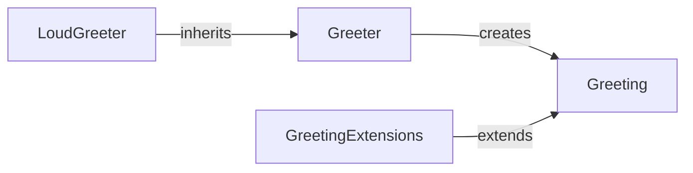

# Getting Started

## Basic usage

Create a <xref:Sample.Core.Greeter> and call <xref:Sample.Core.Greeter.Greet(System.String)> to get a <xref:Sample.Core.Greeting>.

```csharp
var greeting = new Greeter().Greet("World"); // "Hello, World!"
```

## Shouting

Use @Sample.Extensions.LoudGreeter, or call <xref:Sample.Extensions.GreetingExtensions.ToLoud(Sample.Core.Greeting)> on an existing greeting.

## Diagram


