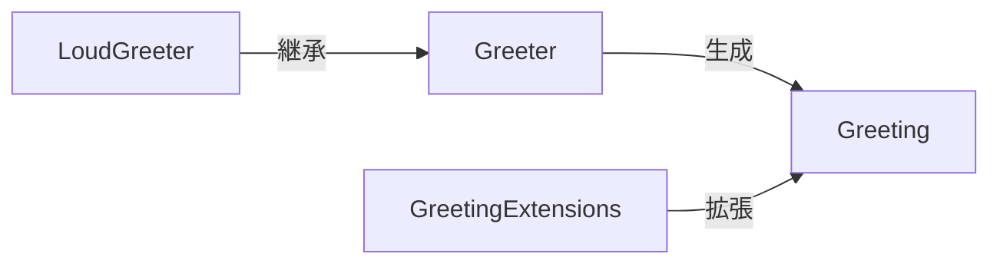

# ガイド

## 基本的な使い方

<xref:Sample.Core.Greeter>を生成し、<xref:Sample.Core.Greeter.Greet(System.String)>を呼び出すと<xref:Sample.Core.Greeting>が得られます。

```csharp
var greeting = new Greeter().Greet("World"); // "Hello, World!"
```

## 大声で挨拶する

@Sample.Extensions.LoudGreeter を使うか、既存の挨拶に対して<xref:Sample.Extensions.GreetingExtensions.ToLoud(Sample.Core.Greeting)>を呼び出します。

## 図


